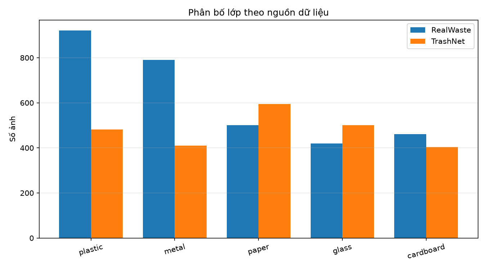
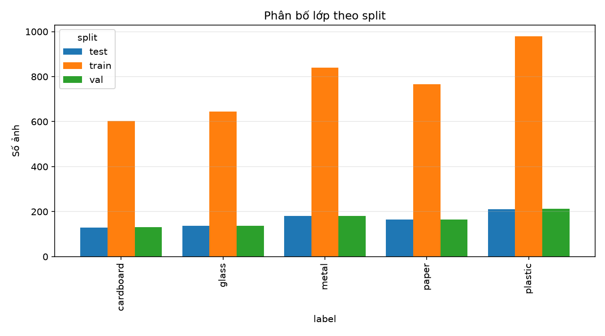
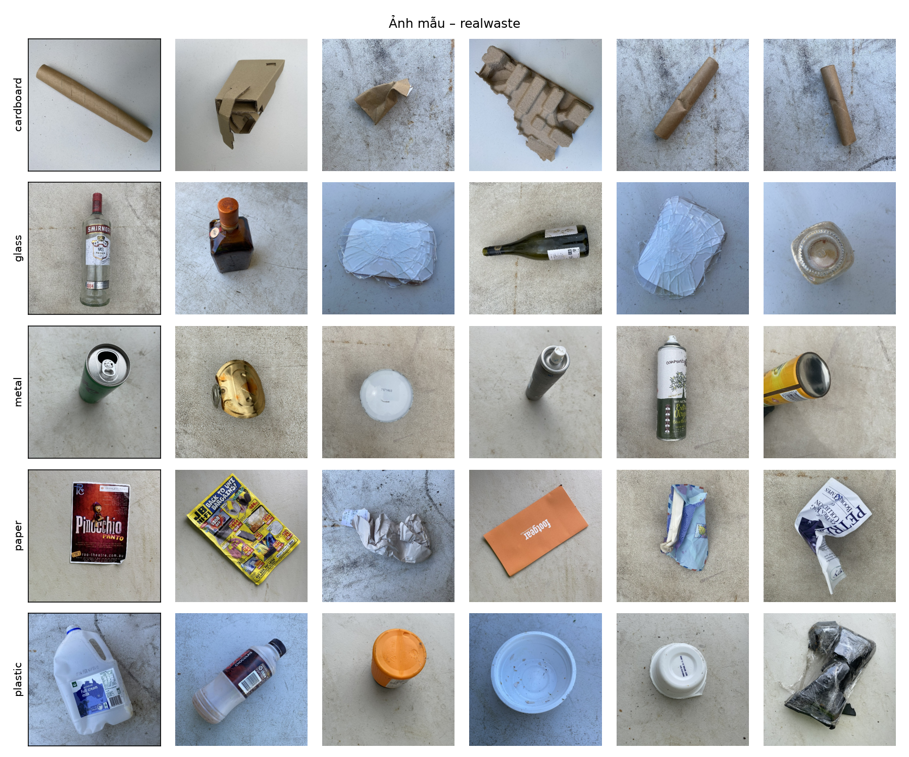
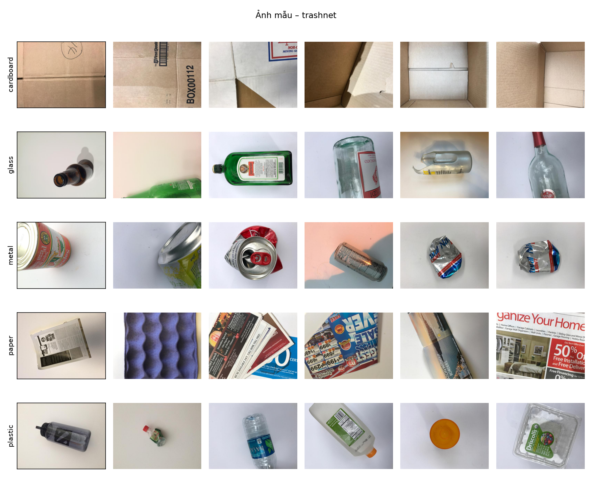
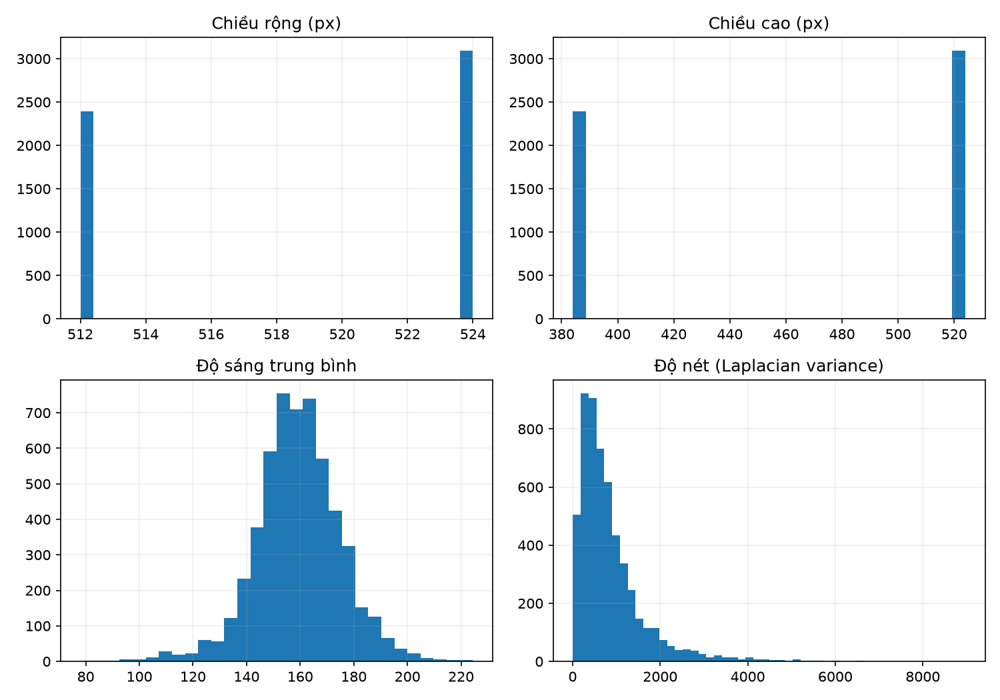
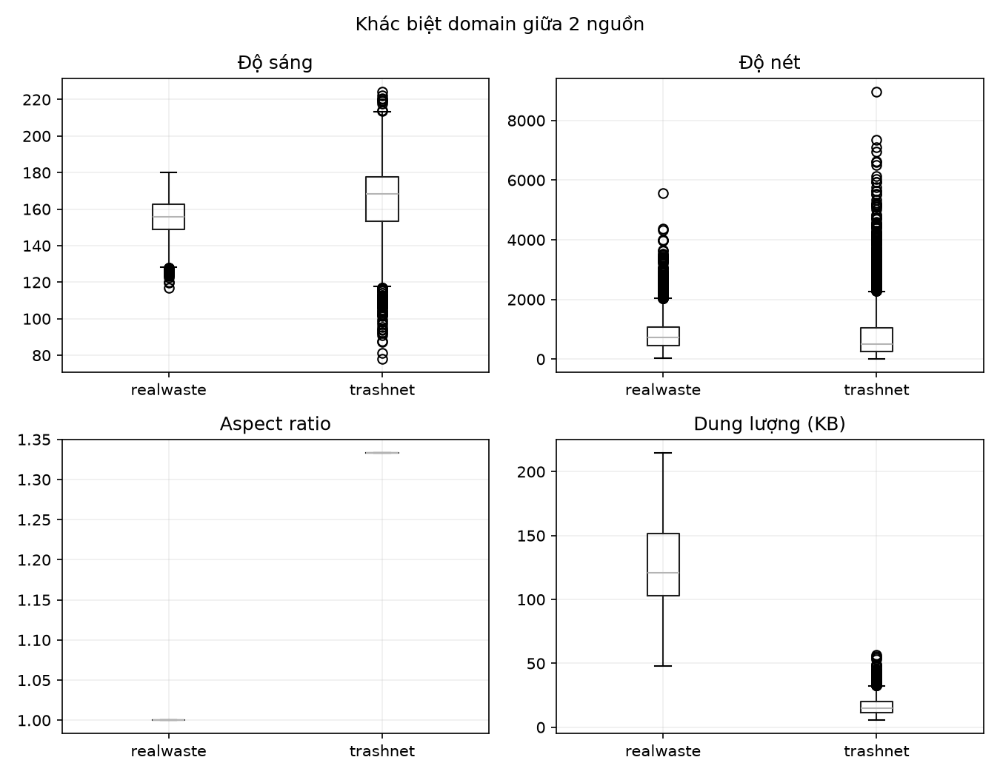
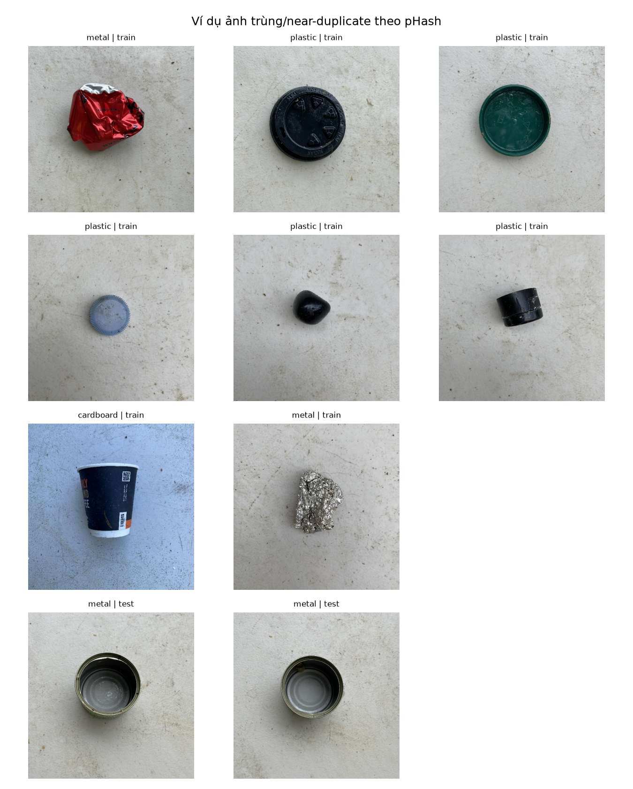
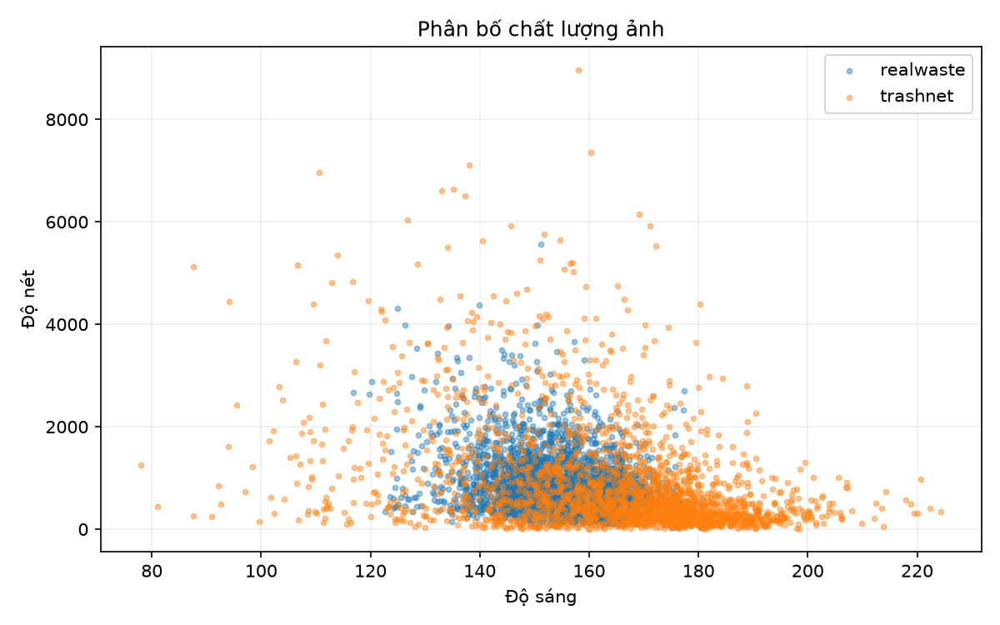

# EDA — Bộ dữ liệu phân loại rác thải 5 lớp

Tài liệu này trình bày khám phá dữ liệu (EDA) cho RealWaste và TrashNet sau khi
mapping về 5 lớp: cardboard, glass, metal, paper, plastic.

- Split: `data/splits/v1/`.
- Phạm vi: cả train, validation và test để mô tả phân bố; test không dùng cho chọn mô hình.
- Sinh tự động bởi `scripts/run_eda.py`; số liệu và hình lấy từ `docs/EDA/`.

## 1. Tóm tắt nhanh

- 5.482 ảnh thuộc 5 lớp, từ 2 nguồn: RealWaste (3.092) và TrashNet (2.390).
- Split 70/15/15: 3.833 train / 826 validation / 823 test.
- Mất cân bằng vừa phải: lớp nhiều nhất (plastic, 1.403) gấp 1,62 lần lớp ít nhất
  (cardboard, 864).
- 33 group ảnh trùng/near-duplicate, tương ứng 35 ảnh dư; trong đó 7 group (15 ảnh)
  có nhãn khác nhau giữa các ảnh trùng.
- 20 ảnh bị đánh giá là mờ theo ngưỡng Laplacian, 4 ảnh quá sáng; không có ảnh quá
  tối, quá nhỏ hoặc không đọc được.
- Khác biệt domain rõ giữa hai nguồn: RealWaste 524×524, nền thực tế; TrashNet
  512×384, nền đơn giản, dung lượng file nhỏ hơn nhiều.
- Tất cả ảnh là JPEG, mode RGB.

## 2. Tổng quan dữ liệu gốc

| Dataset | Tổng ảnh | Số lớp gốc | Ảnh dùng cho 5 lớp | Ảnh bị loại |
|---|---:|---:|---:|---:|
| RealWaste | 4.752 | 9 | 3.092 | 1.660 |
| TrashNet | 2.527 | 6 | 2.390 | 137 |
| **Tổng** | **7.279** | | **5.482** | **1.797** |

Lớp bị loại:

- RealWaste: Food Organics, Miscellaneous Trash, Textile Trash, Vegetation.
- TrashNet: trash.

Lý do: không có lớp tương ứng đủ nhất quán giữa hai nguồn, hoặc ngữ nghĩa khác nhau.
Việc loại bỏ làm giảm 24,7% tổng số ảnh nhưng giúp nhãn 5 lớp nhất quán hơn.

## 3. Phân bố lớp

| Lớp | RealWaste | TrashNet | Tổng | Tỷ lệ |
|---|---:|---:|---:|---:|
| plastic | 921 | 482 | 1.403 | 25,6% |
| metal | 790 | 410 | 1.200 | 21,9% |
| paper | 500 | 594 | 1.094 | 20,0% |
| glass | 420 | 501 | 921 | 16,8% |
| cardboard | 461 | 403 | 864 | 15,8% |

**Nhận xét:**

- Tỷ lệ lớp lớn nhất/nhỏ nhất là 1,62 — không nghiêm trọng nhưng đủ để accuracy
  che lấp hiệu năng lớp thiểu số.
- Vì vậy Macro-F1 là metric chính; class weighting sẽ được kiểm tra ở RQ2.
- RealWaste đóng góp nhiều metal và plastic; TrashNet đóng góp nhiều glass và paper.
  Điều này có nghĩa mỗi nguồn có phân phối lớp khác nhau, ảnh hưởng đến RQ3.

## 4. Phân bố split

| Split | Cardboard | Glass | Metal | Paper | Plastic | Tổng |
|---|---:|---:|---:|---:|---:|---:|
| Train | 603 | 645 | 839 | 766 | 980 | 3.833 |
| Validation | 131 | 138 | 181 | 164 | 212 | 826 |
| Test | 130 | 138 | 180 | 164 | 211 | 823 |

**Nhận xét:**

- Tỷ lệ thực tế: 69,92% train, 15,07% validation, 15,01% test — rất sát 70/15/15.
- Mỗi lớp có ít nhất 130 ảnh ở validation và test, đủ để tính Macro-F1 ổn định.
- Phân bố lớp giữa các split gần như đồng nhất, nên so sánh giữa các mô hình không
  bị lệch do split.

## 5. Ảnh mẫu

RealWaste:

TrashNet:

**Nhận xét:**

- RealWaste: ảnh chụp trong môi trường thực tế, nền phức tạp, ánh sáng thay đổi,
  vật thể có thể bị che một phần.
- TrashNet: vật thể thường đặt trên nền trắng/đơn giản, bố cục rõ ràng hơn.
- Sự khác biệt này là lý do chính khiến bài toán tổng quát hóa (RQ3) có ý nghĩa.

## 6. Thuộc tính ảnh

| Dataset | Width | Height | Aspect | Brightness | Blur | File size |
|---|---:|---:|---:|---:|---:|---:|
| RealWaste | 524 | 524 | 1,00 | 155,2 | 851,1 | 127,5 KB |
| TrashNet | 512 | 384 | 1,33 | 164,5 | 860,0 | 16,9 KB |

**Nhận xét:**

- Toàn bộ ảnh là JPEG, RGB.
- RealWaste vuông 524×524; TrashNet 4:3 (512×384). Khi resize short side 256 rồi
  CenterCrop 224, ảnh TrashNet sẽ mất khoảng 1/3 chiều ngang. Với vật thể đặt ngang,
  có thể cắt mất một phần vật thể.
- RealWaste có dung lượng file trung bình 127,5 KB, cao hơn nhiều so với 16,9 KB của
  TrashNet; phản ánh nền phức tạp và chi tiết hơn.
- Độ sáng trung bình tương đối gần nhau, nhưng độ lệch chuẩn của TrashNet cao hơn
  (nền trắng làm histogram lưỡng cực).
- Không có ảnh quá nhỏ (<128 px) hoặc quá tối; chỉ 4 ảnh quá sáng và 20 ảnh mờ.

## 7. Ảnh trùng và gần trùng

- 33 group có hơn 1 ảnh, tương ứng 35 ảnh dư (0,64%).
- 7 group có nhãn khác nhau giữa các ảnh trùng, tổng cộng 15 ảnh.
- Các cặp nhãn xung đột: cardboard/metal, glass/metal, glass/plastic, metal/plastic,
  metal/plastic, metal/plastic.
- Split v1 đã gom group để tránh leakage; không có group nào nằm ở 2 split.

**Nhận xét:**

- Nếu không gom group, một số ảnh gần trùng có thể xuất hiện ở cả train và test,
  làm kết quả cao giả tạo.
- 7 group xung đột nhãn là nhiễu nhãn tiềm năng. Tỷ lệ nhỏ (15/5.482 ≈ 0,27%)
  nhưng cần ghi nhận trong phần hạn chế.
- Không thay đổi split v1 ở thời điểm này để tránh làm lệch các thí nghiệm đã chạy;
  nếu làm lại dữ liệu, nên xem xét loại hoặc relabel các group này.

## 8. Chất lượng ảnh và nhãn

| Vấn đề | Số ảnh | Ghi chú |
|---|---:|---|
| Quá tối (<45) | 0 | |
| Quá sáng (>220) | 4 | chủ yếu metal của TrashNet |
| Mờ (Laplacian <25) | 20 | 0,36%, chủ yếu TrashNet |
| Cạnh nhỏ (<128 px) | 0 | |
| Không đọc được | 0 | |
| Group xung đột nhãn | 7 group / 15 ảnh | nhiễu nhãn tiềm năng |

**Nhận xét:**

- Chất lượng ảnh nhìn chung tốt; không có ảnh hỏng.
- 20 ảnh mờ có thể là ảnh chụp nhanh hoặc nền trắng làm Laplacian thấp; không nên
  loại bỏ hàng loạt vì sẽ làm mất dữ liệu lớp ít.
- 7 group xung đột nhãn nên được nêu như hạn chế của dataset, không tự ý sửa nhãn
  sau khi đã tạo split.

## 9. Nhận xét tổng hợp và hàm ý

1. **Mất cân bằng lớp vừa phải**: cần Macro-F1, không chỉ accuracy; class weighting
   là một giả thuyết hợp lý cho RQ2.
2. **Khác biệt domain rõ**: RealWaste nền phức tạp, TrashNet nền đơn giản; transfer
   learning và cross-dataset evaluation là cần thiết.
3. **Ảnh TrashNet 4:3 bị crop khi dùng 224×224**: có thể làm mất vật thể; cần ghi
   nhận hạn chế hoặc thử augmentation/padding ở RQ2.
4. **Dữ liệu sạch nhưng không hoàn hảo**: ảnh hỏng = 0, nhưng có 7 group xung đột
   nhãn; không nên overfit vào con số accuracy tuyệt đối.
5. **Split ổn định**: phân bố lớp giữa train/val/test đồng nhất, test đủ lớn để
   đánh giá.
6. **Tất cả ảnh JPEG/RGB**: không cần xử lý kênh alpha hay định dạng đặc biệt.
7. **Có thể dùng 224×224**: kích thước gốc đủ lớn; tuy nhiên cần kiểm tra trực quan
   ảnh sau crop.

## 10. Hạn chế của EDA

- Phân tích chất lượng dựa trên ngưỡng heuristic (brightness, Laplacian), không thay
  thế kiểm tra thủ công toàn bộ.
- Chưa có đánh giá chủ quan của con người trên tất cả ảnh.
- Chưa phân tích embedding/UMAP; không cần cho phạm vi đồ án.
- EDA trên cả test set để mô tả phân bố, nhưng test không được dùng cho chọn mô hình.

## 11. File sinh tự động

| File | Nội dung |
|---|---|
| `tables/image_stats.csv` | Thống kê từng ảnh |
| `tables/class_counts.csv` | Số ảnh theo lớp/nguồn |
| `tables/split_counts.csv` | Số ảnh theo split/lớp |
| `tables/domain_summary.csv` | So sánh 2 nguồn |
| `tables/duplicates.csv` | Group ảnh trùng |
| `tables/quality_issues.csv` | Ảnh lỗi/ngoại lệ |
| `tables/raw_label_counts.csv` | Count nhãn gốc và lớp bị loại |
| `summary.json` | Tóm tắt số liệu |
| `figures/*.png` | Hình EDA |

Notebook: `notebooks/shared/eda.ipynb`.
